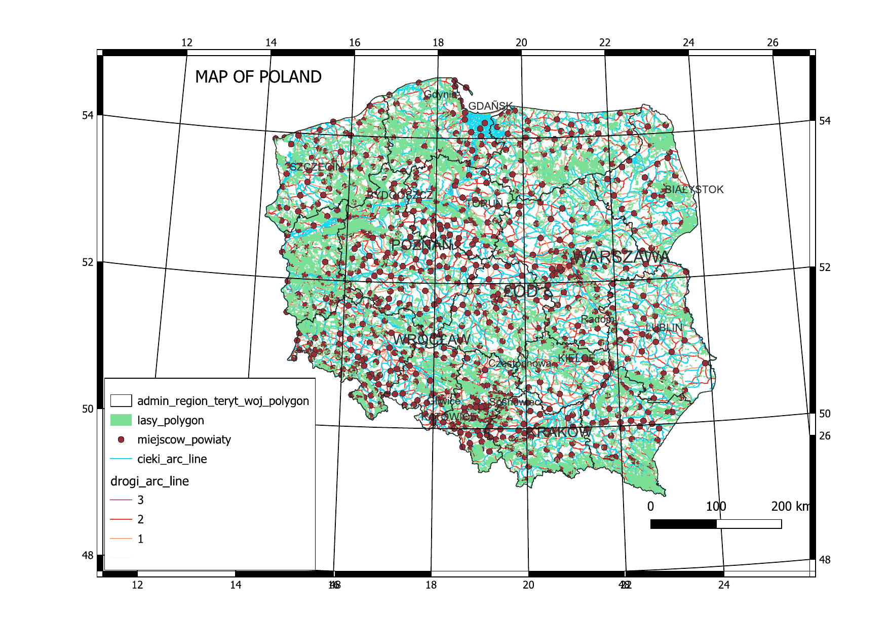
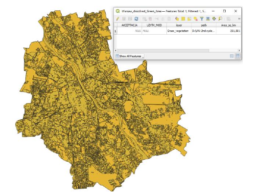
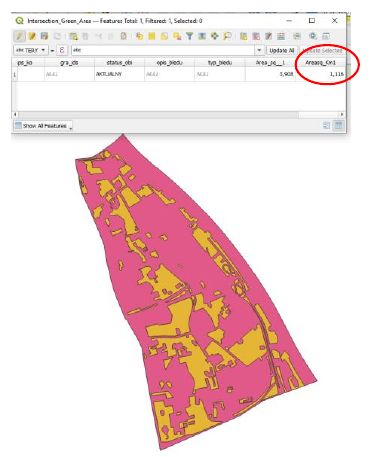
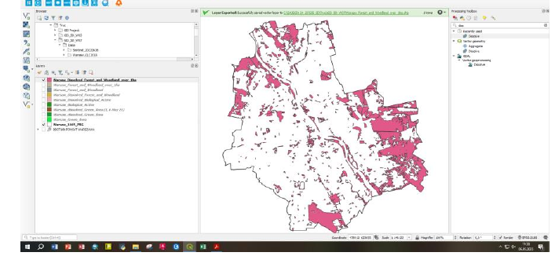
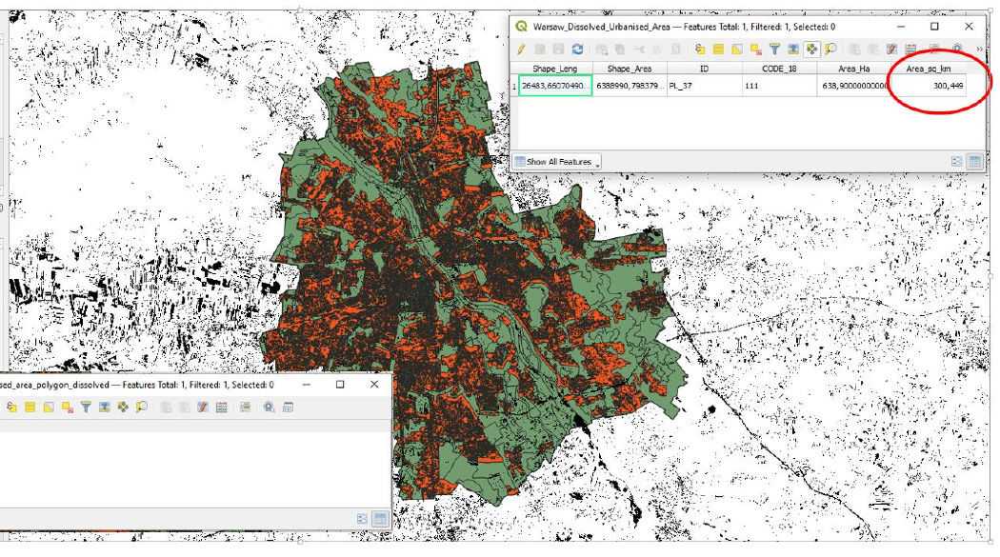
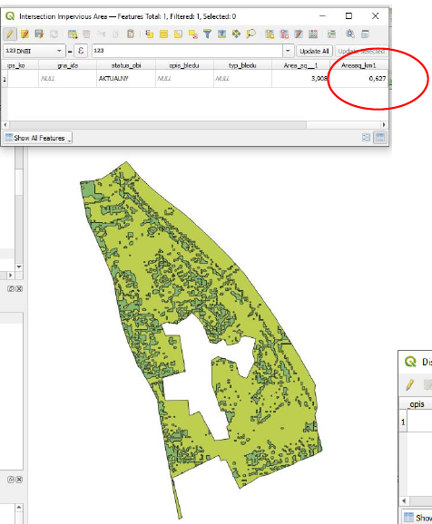
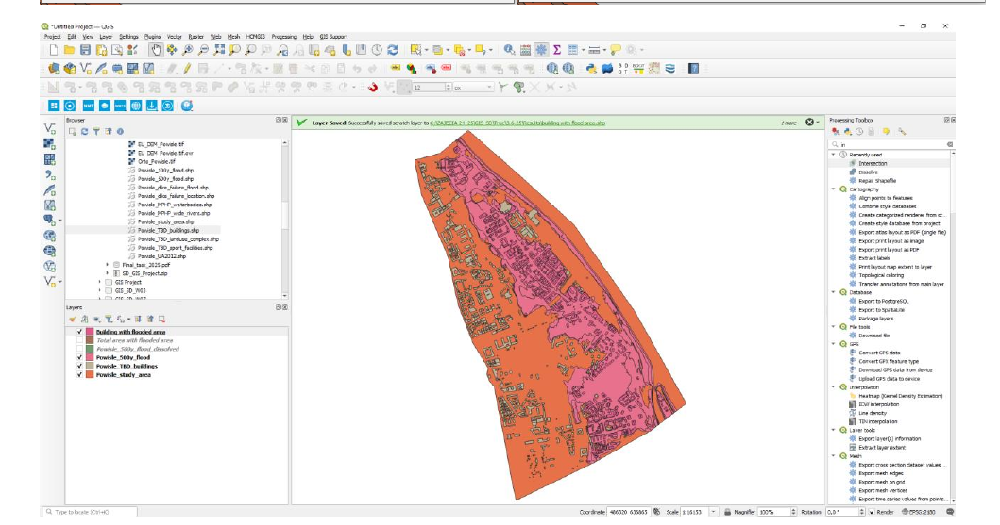
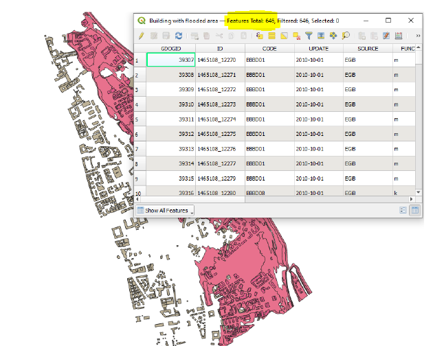

These maps come from the course *Geographic Information System (GIS) as support in
decision-making process* (2024/25), part of my MSc in Sustainable Development at the
University of Warsaw. The course used one question throughout: how can a GIS turn spatial
layers into numbers a planner can act on? I worked through it in three steps — first a basic
national map, then four environmental indicators for the whole of Warsaw and for the
riverside district of Powiśle, and finally a flood-risk assessment for Powiśle's buildings.

All work was done in **QGIS**, in the Polish national coordinate system **ETRS89 / Poland
CS92 (EPSG:2180)**, so that areas could be measured in square kilometres.

## Step 1: a map of Poland

My first layout exercise combined five vector layers: voivodeship boundaries, forests,
county towns, rivers and the road network, with roads styled by class.

## Step 2: four environmental indicators for Warsaw and Powiśle

**Workshop 7, May 2025.** I calculated the same four indicators at two scales: the whole
city of Warsaw (20 May) and the Powiśle area (27 May). Each indicator follows the same
pattern: select or dissolve the relevant land-cover polygons, measure their area, and divide
by a reference area or population.

| Indicator | Warsaw | Powiśle |
|---|---:|---:|
| Total area | 517.20 km² | 3.91 km² |
| Residents | 1 861 980 | 28 303 |
| 1. Green area resources (green area ÷ total area) | **48.6 %** | **28.6 %** |
| 2. Water retention potential (biologically active surfaces ÷ total area) | **53.8 %** | **38.7 %** |
| 3. Forests and woodlands over 1 ha, per resident | **58.2 m²/person** | **17.4 m²/person** |
| 4. Impervious surfaces (share of the urbanised area) | **19.9 %** | **22.0 %** |

: Underlying areas — Warsaw: green 251.58 km², biologically active 278.23 km², forest > 1 ha 108.36 km², urbanised 300.45 km², impervious 59.66 km². Powiśle: green 1.116 km², biologically active 1.513 km², forest > 1 ha 0.493 km², urbanised 2.855 km², impervious 0.627 km².

::: {layout-ncol=2}

:::

::: {layout-ncol=2}

:::

### What the numbers say

Powiśle is much less green than Warsaw as a whole. Its share of green area is 20 percentage
points lower, its water retention potential is 15 points lower, and each resident has less
than a third of the large forest and woodland area that the average Warsaw resident has.
It is also slightly more sealed: 22 % of its urbanised area is impervious, against about
20 % for the city. City-wide averages can therefore hide dense central districts where
green infrastructure is scarcest — exactly where it matters most for heat and stormwater.

## Step 3: buildings in Powiśle's 500-year flood zone

**Final task, 3 June 2025.** Powiśle lies along the Vistula, so the last task asked how much
of it would be covered by a 500-year flood and what protecting its buildings would cost.

1. **Flooded share of the district.** I dissolved the 500-year flood layer and compared its
   area with the study area: 1.457 km² ÷ 3.886 km² = **37.5 %**.
2. **Buildings at risk.** Intersecting the building layer with the flooded area selected
   **646 buildings**.
3. **Cost of flood insurance.** At the assumed average of US$150 per building:
   646 × US$150 = **US$96,900**.

More than a third of Powiśle is exposed to a rare but high-impact Vistula flood. From a
visual check, most of the 646 buildings appear to be residential, which points to the need
for community-level flood awareness and insurance support. If critical infrastructure such
as schools or hospitals falls inside the zone, it should be prioritised for protection or
relocation planning. Results like these can feed directly into planning decisions: stricter
building codes in the floodplain, better drainage, and an early-warning system.

## What I took from the course

- **The same method works at any scale.** One indicator workflow gave comparable results for
  a city of 517 km² and a district of 4 km² — and comparing them was more informative than
  either on its own.
- **Boundaries change results.** My two Powiśle exercises used slightly different study-area
  layers (3.908 km² and 3.886 km²). The difference is small here, but it is a reminder to
  state which boundary every percentage is based on.
- **A count is the start of a risk assessment, not the end.** The insurance estimate treats
  every building the same; flood depth, building use and value would make it far more
  useful.

## Next steps

I want to rebuild these workflows in R (`sf`, `terra`) so they are fully reproducible, and
extend them to land surface temperature, so that green space, sealing and heat can be read
together.
