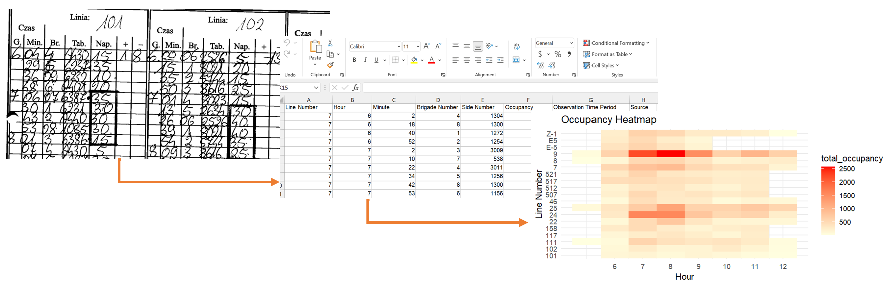
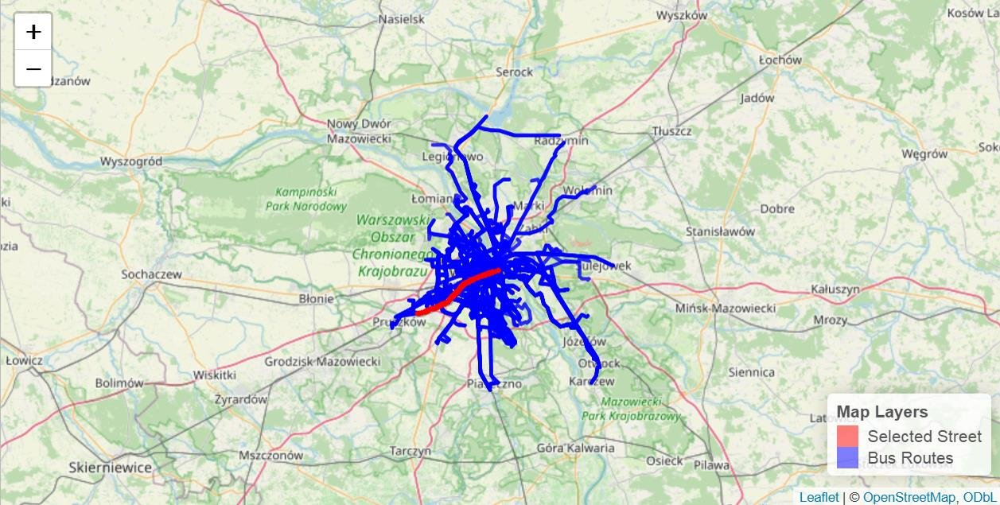
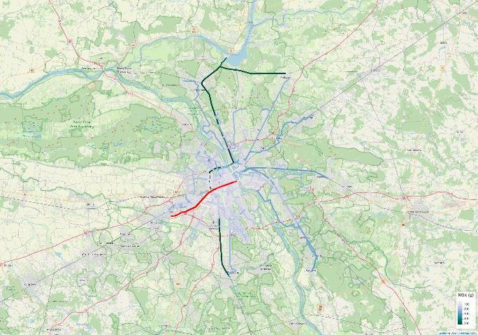
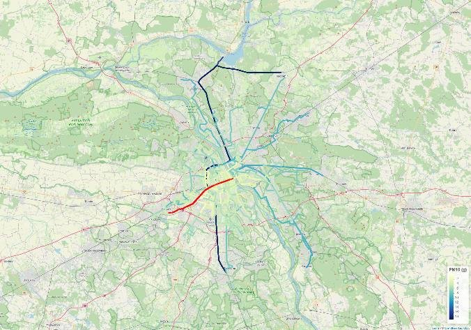
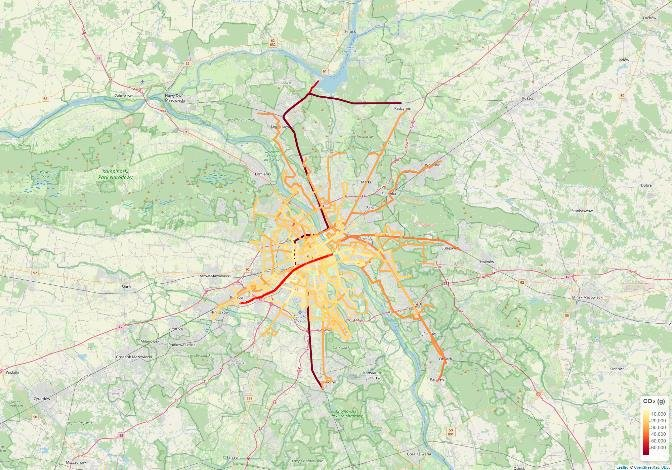
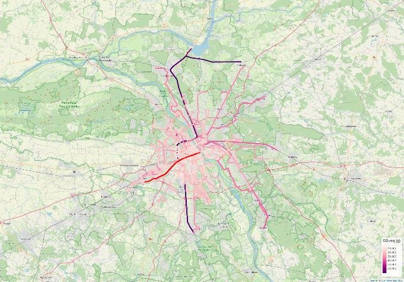

`Mar – May 2026`

**Full title:** *Carbon Footprint Assessment of Road and Passenger Traffic for a Selected Street in Warsaw, Poznań, Wrocław and Kraków*

**Topics:** urban transport · GHG accounting · air pollutants · geospatial analysis · SDG 11 & SDG 13

**My contributions:** data digitisation, R modelling, emission calculations, GIS mapping

**Skills used:** R, QGIS, GTFS transit data, OpenStreetMap, Geoportal (BDOT10k), AI-assisted digitisation (NotebookLM)

## At a glance

| | |
|---|---|
| **Host** | [Institute for Sustainable Development Foundation](https://www.pine.org.pl/english/) (Instytut na rzecz Ekorozwoju), Warsaw |
| **Programme** | MSc in Sustainable Development, University of Warsaw (research study) |
| **Period** | March – April 2026, ~150 working hours, hybrid |
| **Cities** | Warsaw, Poznań, Wrocław, Kraków |
| **Pollutants** | CO₂, NOx, PM10 and CO₂-equivalent |

## Why it matters

Transport is one of the main sources of greenhouse gas emissions in cities, and adding road capacity often brings more traffic and more emissions. Planners need to know **where** emissions concentrate so they can act on the right streets. The Institute's existing Excel-based inventory focused mainly on cars, with public transport covered only roughly. This project built more flexible, map-based tools to fill that gap.

## What I did

### 1. Turned handwritten traffic logs into data

I digitised **180 handwritten traffic records** from Warsaw bus stops (line, arrival time, vehicle and passengers boarding or leaving) with AI support. I cleaned them into structured files, then wrote an R script to calculate total and average occupancy and map it as a heatmap by line and hour.

{fig-align="center"}

### 2. Mapped road emissions street by street

Using the city's GHG inventory, I mapped emissions for each road segment in **Poznań**, then applied the same method to **Wrocław** and **Kraków**:

- downloaded city boundaries and road networks from OpenStreetMap and Geoportal
- extracted the city road layer in QGIS
- merged road geometry with emission data in R, after standardising Polish street names and characters
- produced emission intensity maps in QGIS

The Poznań results use the Institute's internal data and are kept confidential.

### 3. Built an R model for public transport emissions

Because the inventory paid little attention to buses, I built a new **R model** for Warsaw's public transport. It combines official **GTFS timetable data** from ZTM Warszawa with OpenStreetMap streets. I focused on one major corridor, **Aleje Jerozolimskie**, and the bus lines crossing it.

{fig-align="center"}

For each route segment, the model calculates length and travel time (at an average 18 km/h), applies emission factors for CO₂, NOx and PM10, and sums emissions per route and as CO₂-equivalent.

::: {layout-ncol=2}

:::

## Key findings

- **Emissions are concentrated on major corridors**, not spread evenly across the city
- **High-capacity roads** tend to carry more traffic and produce more emissions
- **Emission maps reveal real hotspots**, allowing more targeted policies
- **Data quality is the main bottleneck**: encoding errors, inconsistent street names and gaps between datasets meant about 80% of Poznań's roads could be matched and mapped, so data standardisation is essential

## Contributions to the Institute

- A new **R-based modelling framework** that goes beyond Excel tools
- A **reproducible GIS method** for street-level emission mapping
- A list of **key data gaps** to fix
- Evidence to support policies such as targeting high-emission roads, improving public transport planning and strengthening data systems

## Limitations

The public transport model is a simplified (Tier 1) approach. It assumes constant speed and a linear link between distance and emissions, and does not yet distinguish vehicle types, fuels (diesel vs. electric), stop-and-go driving or congestion. A natural next step is to use emission factors from the EMEP/EEA guidebook.

---

[← Back to all projects](../../projects.qmd)
