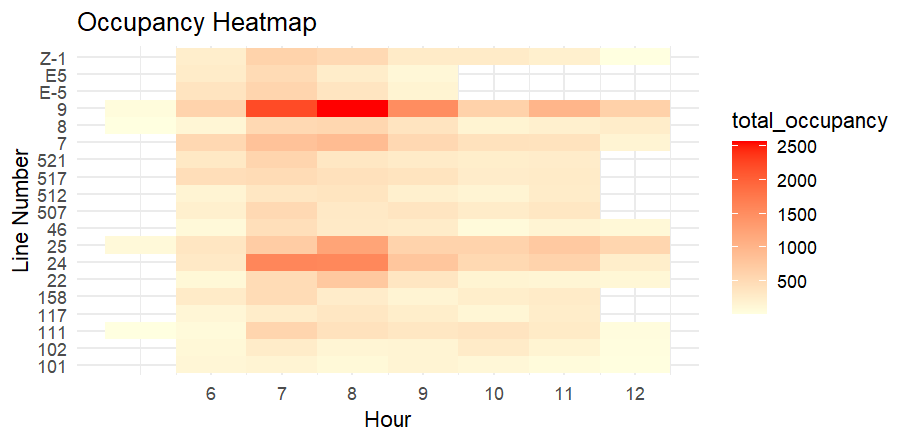
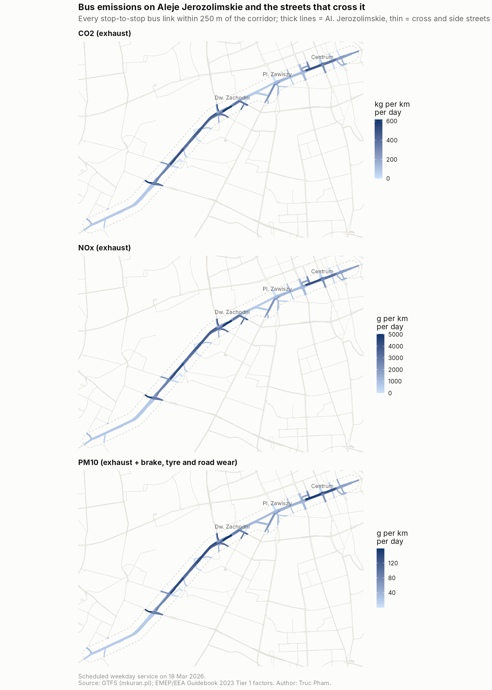
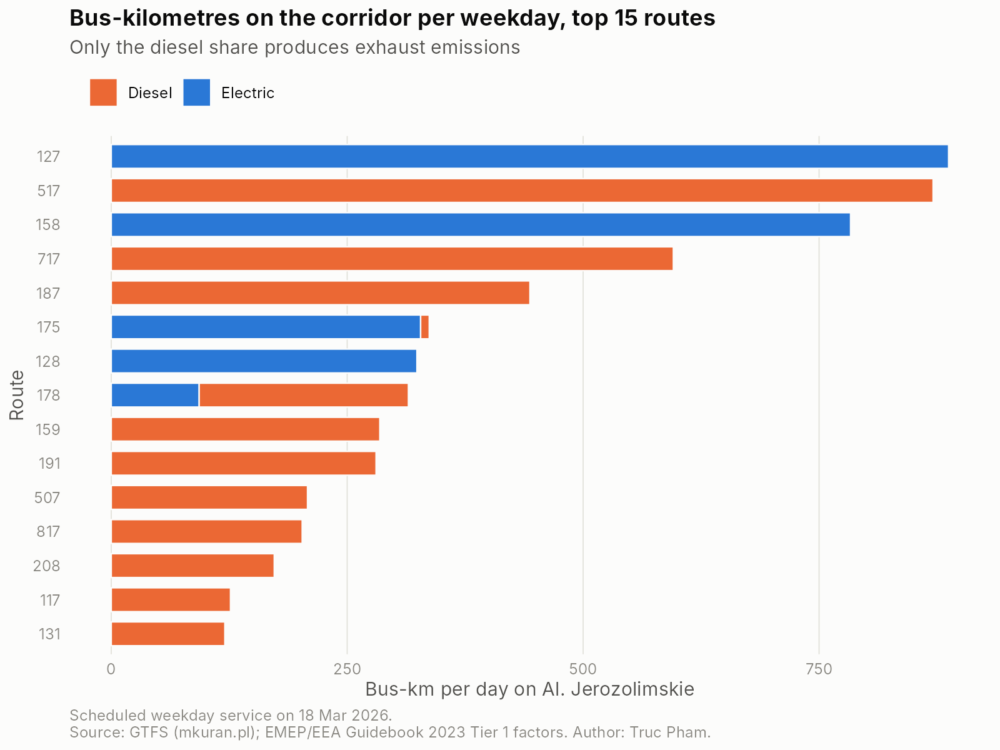
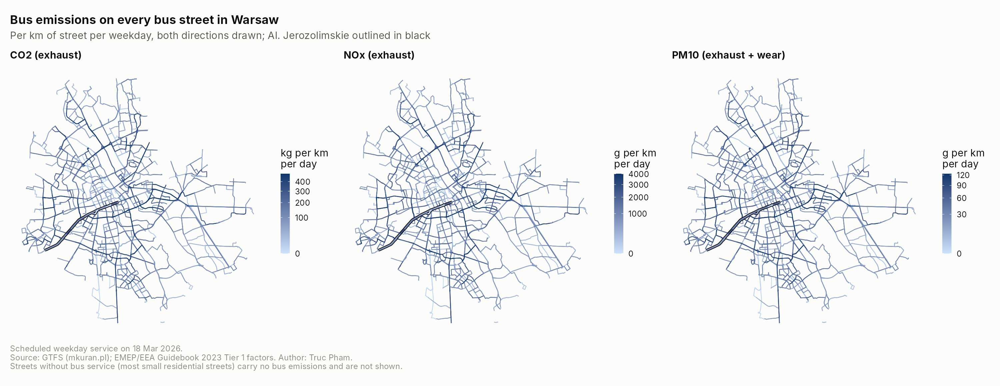
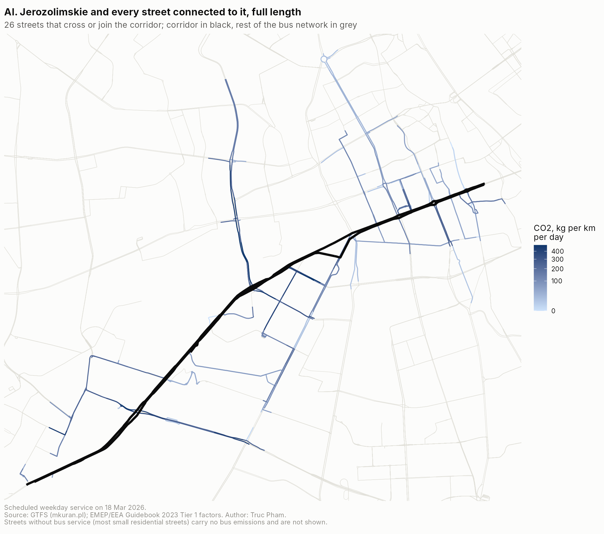

`Mar – May 2026`

**Full title:** *Carbon Footprint Assessment of Road and Passenger Traffic for a Selected Street in Warsaw, Poznań, Wrocław and Kraków*

**Topics:** urban transport · GHG accounting · air pollutants · geospatial analysis · SDG 11 & SDG 13

**My contributions:** passenger occupancy analysis, R modelling, emission calculations, GIS mapping

**Skills used:** R (data.table, sf, ggplot2), QGIS, GTFS transit data, OpenStreetMap, Geoportal (BDOT10k)

## At a glance

| | |
|---|---|
| **Host** | [Institute for Sustainable Development Foundation](https://www.pine.org.pl/english/) (Instytut na rzecz Ekorozwoju), Warsaw |
| **Programme** | MSc in Sustainable Development, University of Warsaw (research study) |
| **Period** | March – April 2026, ~150 working hours, hybrid |
| **Cities** | Warsaw, Poznań, Wrocław, Kraków |
| **Pollutants** | CO₂, NOx and PM10 |

## Why it matters

Transport is one of the main sources of greenhouse gas emissions in cities, and adding road capacity often brings more traffic and more emissions. Planners need to know **where** emissions concentrate so they can act on the right streets. The Institute's existing Excel-based inventory focused mainly on cars, with public transport covered only roughly. This project built more flexible, map-based tools to fill that gap.

## What I did

### 1. Passenger occupancy by line and hour

From the Institute's passenger counts at Warsaw stops, I wrote an R script that totals occupancy by line and hour. The morning peak between 07:00 and 08:00 stands out, and the busiest services are tram lines 9, 24 and 25.

{fig-align="center"}

### 2. Mapped road emissions street by street

Using the city's GHG inventory, I mapped emissions for each road segment in **Poznań**, then applied the same method to **Wrocław** and **Kraków**:

- downloaded city boundaries and road networks from OpenStreetMap and Geoportal
- extracted the city road layer in QGIS
- merged road geometry with emission data in R, after standardising Polish street names and characters
- produced emission intensity maps in QGIS

The Poznań results use the Institute's internal data and are kept confidential.

### 3. Built an R model for public transport emissions

Because the inventory paid little attention to buses, I built an **R model** for Warsaw's public transport from official **GTFS timetable data** (ZTM Warszawa), focused on one major corridor, **Aleje Jerozolimskie**. After the internship I refined it so that it:

- counts every scheduled bus trip on a regular weekday (18 March 2026), not just each route once
- keeps only buses that actually travel along the street, by matching stops recorded on Al. Jerozolimskie, and drops routes that only cross it
- reads each trip's vehicle type from the timetable, so **electric buses count as zero** tailpipe emissions
- applies cited emission factors from the EMEP/EEA Guidebook 2023 for CO₂, NOx and PM10, including PM10 from brake, tyre and road wear
- adds the cross streets within 250 m of the corridor, counting crossing routes only for the stretch near the street

{fig-align="center"}

On that weekday, **3,505 bus trips on 38 routes** cover about **6,700 bus-km** on the corridor and emit about **5.4 t of CO₂, 44 kg of NOx and 1.6 kg of PM10**. Electric buses already run **37% of the bus-km**, which avoids roughly 3.4 t of CO₂ a day compared with diesel buses of the same size. Brake, tyre and road wear make up **41% of bus PM10**, and electric buses still produce it. Including the cross streets, the 250 m zone totals **14.2 t of CO₂** a day.

{fig-align="center"}

To see the corridor in context, I extended the model to every bus street in Warsaw. On a weekday the city's buses run about **315,000 bus-km** and emit about **347 t of CO₂**. Al. Jerozolimskie ranks **5th of all Warsaw bus streets** for bus CO₂.

{fig-align="center"}

The 26 streets that cross or join the corridor add about **15 t of CO₂** a day over their full length, led by al. Prymasa Tysiąclecia and Łopuszańska.

{fig-align="center"}

Code and data: [github.com/truc-pham/GHG_transportation_warsaw](https://github.com/truc-pham/GHG_transportation_warsaw)

## Key findings

- **Emissions are concentrated on major corridors**, not spread evenly across the city
- **High-capacity roads** tend to carry more traffic and produce more emissions
- **Emission maps reveal real hotspots**, allowing more targeted policies
- **Data quality is the main bottleneck**: encoding errors, inconsistent street names and gaps between datasets meant about 80% of Poznań's roads could be matched and mapped, so data standardisation is essential

## Contributions to the Institute

- A new **R-based modelling framework** that goes beyond Excel tools
- A **reproducible GIS method** for street-level emission mapping
- A list of **key data gaps** to fix
- Evidence to support policies such as targeting high-emission roads, improving public transport planning and strengthening data systems

## Limitations

The public transport model is a simplified, fuel-based (Tier 1) approach. Fuel use per bus size is assumed, hybrid and CNG buses are treated as diesel, and congestion and stop-and-go driving are not modelled. Natural next steps are operator fuel data and COPERT Tier 2 factors by Euro standard.

---

[← Back to all projects](../../projects.qmd)
