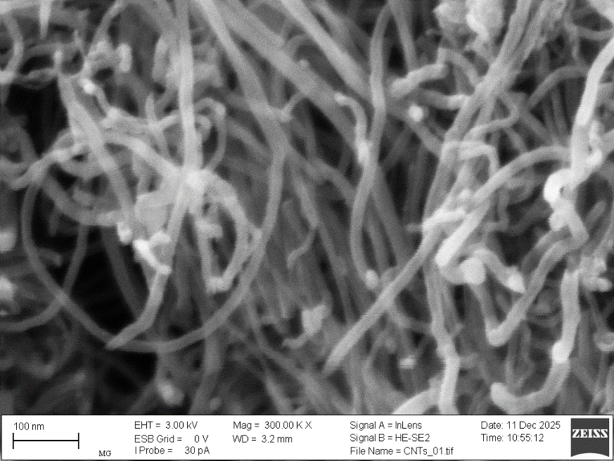
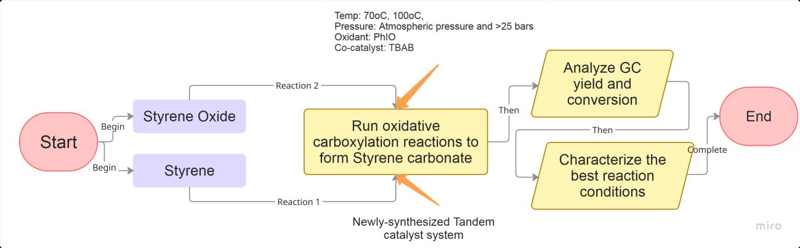
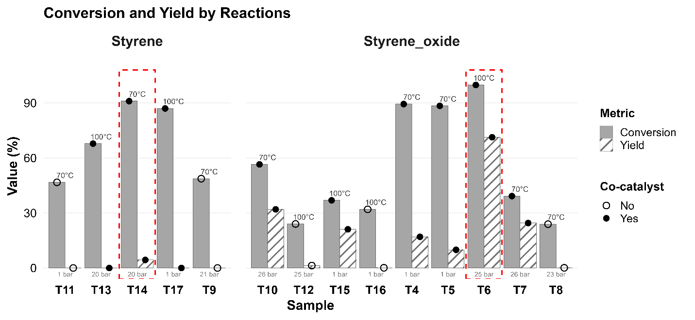

`2024 – 2026`

**Full title:** *Sustainable conversion of CO₂ into cyclic organic carbonates using selected tandem catalysts based on carbon nanotubes*

**Topics:** carbon capture and utilisation · green chemistry · heterogeneous catalysis · nanomaterials

**My contributions:** catalyst design and synthesis, material characterisation, catalytic testing, data analysis

**Skills used:** nanomaterial synthesis, UV-Vis spectrophotometry, SEM-EDS, gas chromatography (GC), thin-layer chromatography (TLC), high-pressure reactor work, data visualisation

## Thesis at a glance

| | |
|---|---|
| **Degree** | MSc in Sustainable Development, with Distinction |
| **Institution** | University Centre for Environmental Studies and Sustainable Development, University of Warsaw |
| **Supervisor** | Dr. hab. Elżbieta Megiel, Associate Professor, Faculty of Chemistry, University of Warsaw |
| **Completed** | July 2026 |
| **Best result** | 99.8% conversion and 71.3% yield of styrene carbonate |

## Why it matters

CO₂ is the main greenhouse gas, and switching to renewable energy alone is not enough to bring emissions down. **Carbon capture and utilisation (CCU)** offers a complementary route: treating CO₂ as a raw material instead of waste.

One of the most promising CCU products are **cyclic organic carbonates (COCs)**, used in batteries, green solvents and polymers. They are usually made from CO₂ and epoxides, which are toxic. A cleaner alternative is **oxidative carboxylation**: starting from cheaper, safer olefins and converting them to carbonates in a single "one-pot" process. This requires a catalyst that can do two jobs at once.

## What I did

I designed and synthesised a new **tandem catalyst** combining two types of active sites on one support:

- **Multiwalled carbon nanotubes (MWCNTs)**, a support material that can be produced from organic waste, functionalised with **tetrazolium–bromide** groups to drive CO₂ cycloaddition
- **Silver nanoparticles stabilised with polyethyleneimine (AgNPs•PEI)** to drive the epoxidation step

{width=70% fig-align="center"}

I then tested the catalyst on two model reactions, using styrene oxide and styrene, under mild conditions (70–100 °C, 1–26 bar CO₂), with and without a co-catalyst (TBAB).

{fig-align="center"}

## Key findings

{fig-align="center"}

- **CO₂ + styrene oxide:** up to **99.8% conversion** and **71.3% yield** of styrene carbonate (71.5% selectivity) at 100 °C and 25 bar, competitive with other heterogeneous catalysts reported to date
- **One-pot route from styrene:** high conversion (up to **91%**) but low carbonate yield (below 5%), showing that selectivity, not conversion, is the bottleneck
- **The co-catalyst is essential:** adding TBAB raised the average yield from **0.5% to 29.3%**; without it, yields stayed near zero regardless of temperature or pressure
- **Catalyst design matters:** placing separate active sites on one support can reduce selectivity, pointing future work towards better-integrated catalyst designs

## Next steps

- Test the catalyst variant with higher-molecular-weight PEI (PEI-25k)
- Quantify by-products such as benzaldehyde by GC
- Use a two-temperature programme in the one-pot system: lower for epoxidation, higher for cycloaddition
- Test other oxidants (O₂, H₂O₂) and assess catalyst recyclability over multiple cycles

## Outcomes

### Review paper

The literature research in this thesis contributes to a review paper:

- Megiel, E., **Pham, H. T.** Polymer-based advanced catalytic systems for the thermal conversion of CO₂ into five-membered cyclic organic carbonates: A comprehensive review. *Journal of CO₂ Utilization*. Under revision, 2026.

### Conference presentation

- Megiel, E., Wasiluk, K., Kopacka, G., **Pham, H. T.**, Gungor, S. (2026). Sustainable catalytic conversion of CO₂ to cyclic organic carbonates using hybrid nanomaterials.

**Keywords:** CO₂ fixation · cyclic organic carbonates · oxidative carboxylation · CO₂ cycloaddition · tandem catalyst · multiwalled carbon nanotubes · silver nanoparticles · styrene carbonate · heterogeneous catalysis

---

[← Back to all projects](../../projects.qmd)
