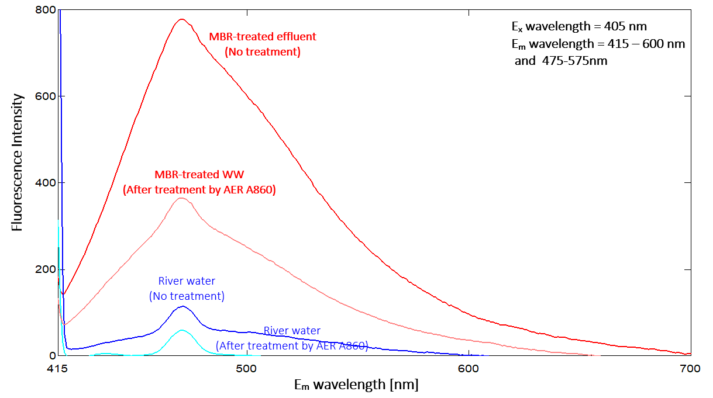
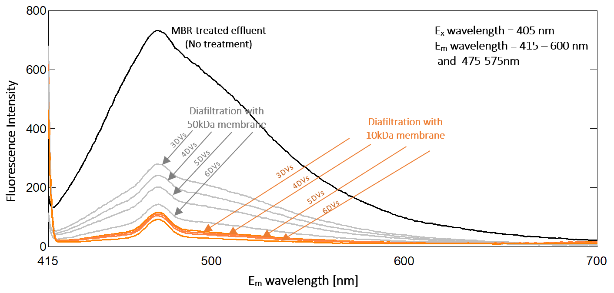
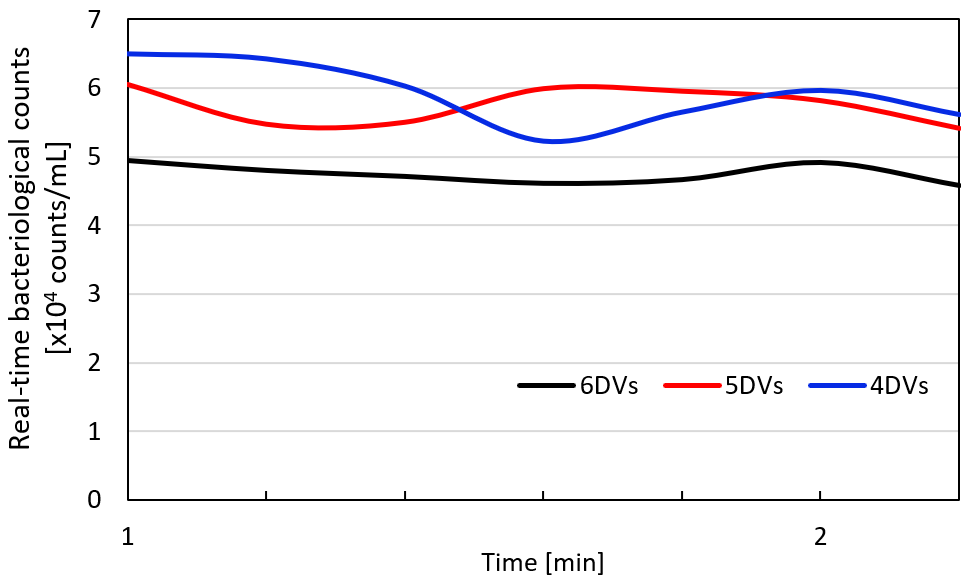

`2018 – 2020`

**Full title:** *Development of pre-treatment for real-time bacterial counting* (リアルタイム微生物計測に対する前処理手法の開発)

**Topics:** microbial water quality · wastewater treatment · membrane filtration · online monitoring

**My contributions:** experimental design, pre-treatment system operation, fluorescence and bacterial analysis

**Skills used:** ion exchange, diafiltration, fluorescence spectrophotometry, online bacteriological counting, epifluorescence microscopy

## Thesis at a glance

| | |
|---|---|
| **Degree** | MEng in Water and Environmental Engineering |
| **Programme** | Integrated Engineering, International Water Environmental Engineering Course, Nagasaki University |
| **Completed** | July 2020 |
| **Water tested** | MBR-treated wastewater and river water |
| **Key result** | Diafiltration with a 10 kDa membrane (from 4 diafiltration volumes) enabled error-free online bacterial counting |

## Why it matters

Safe water depends on knowing how many bacteria remain after treatment. Common methods such as Heterotrophic Plate Count (HPC) and Flow Cytometry (FCM) work well, but they are **not suited to continuous, long-term monitoring**.

**Real-time bacterial counting** can monitor water continuously, but it has a weak spot: dissolved organic matter, especially **humic acid-like substances**, gives off fluorescence that interferes with the measurement. This thesis set out to remove those interfering substances **while keeping the bacteria**, so they can still be counted accurately.

## What I did

I developed and compared two pre-treatment methods:

**1. Fluidized bed ion exchange**

- An ion exchange column (Φ18 × 300 mm) filled with commercial **anion exchange resin A860**
- MBR-treated wastewater and river water pumped upward through the resin at 40 mL/min

**2. Diafiltration**

- Membranes with two molecular weight cut-offs: **10 kDa and 50 kDa**
- Water concentrated at 40 mL/min and 2 bar, then diluted back with buffer, repeated for **3, 4, 5 and 6 diafiltration volumes (DVs)**

All treated samples were analysed with a **fluorescence spectrophotometer**, an **online bacteriological counting system** and **epifluorescence microscopy**.

## Key findings

### Ion exchange works for river water, not for wastewater

{fig-align="center"}

- Treated **river water** reached low fluorescence (below 100) and could be counted online
- Treated **MBR wastewater** still showed high fluorescence (around 400), too high for online counting

### Diafiltration with a 10 kDa membrane is the winner

{fig-align="center"}

- The **10 kDa membrane** removed far more interfering substances than the 50 kDa membrane
- From **4 diafiltration volumes onwards**, treated wastewater could be counted online without errors

{width=75% fig-align="center"}

## Conclusion

Both methods reduced dissolved organic matter in MBR-treated wastewater, but only **diafiltration with a 10 kDa membrane** removed enough interfering substances for reliable real-time counting. This makes it a promising pre-treatment step to support **continuous microbial monitoring** in water and wastewater treatment.

---

[← Back to all projects](../../projects.qmd)
